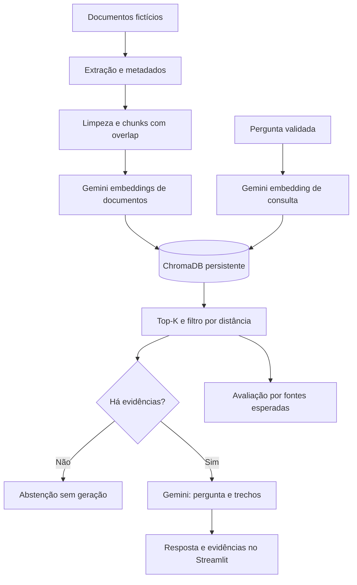

# NexaPolicy — Assistente de políticas internas

Assistente RAG para consultar férias, reembolsos, benefícios e onboarding da **NexaCorp, empresa fictícia**, com trechos recuperados para conferência. Projeto de portfólio de AI Engineering, originado no Challenge AluraAgente — ONE IA for Tech.

O projeto ajuda a localizar regras dispersas e a conferir sua origem. Uma resposta pode reunir informações de documentos diferentes, preservando os trechos consultados. Foi desenvolvido para demonstrar ingestão documental, recuperação semântica, avaliação e tratamento explícito de falhas; não há medição de economia de tempo ou uso por empresas reais.

**Caso de uso:** um colaborador precisa descobrir quais políticas se aplicam a uma solicitação e onde conferir a informação. Exemplo: “Quais treinamentos preciso fazer na primeira semana e qual é a verba anual para cursos?”. A recuperação pode fornecer evidências de onboarding e benefícios no mesmo contexto.

Não há dados de clientes, métricas de impacto ou uso em produção comprovados. O sistema consulta documentos; não aprova solicitações nem executa ações corporativas. Instruções de prompt não garantem correção ou resistência a prompt injection.

## O que este projeto demonstra

- Ingestão recursiva de PDF, DOCX, XLSX, PPTX, Markdown, CSV, JSON e HTML, com metadados e IDs SHA-256 determinísticos.
- Embeddings Gemini e índice ChromaDB persistente, com busca por distância de cosseno.
- Até `TOP_K` trechos abaixo do limiar, permitindo contexto com múltiplas fontes.
- Evidências com caminho relativo, localização, texto e distância. Respostas sem citação ou com número de fonte inválido são substituídas pela abstenção. A checagem não verifica se a fonte sustenta a afirmação.
- Abstenção sem geração quando nenhum trecho passa pelo limiar. A mensagem padrão de abstenção retornada pelo modelo também não recebe fontes.
- Avaliação de recuperação com 15 perguntas curadas, incluindo duas compostas e quatro sem resposta.
- Testes sem credenciais, incluindo Chroma real com vetores controlados e interface Streamlit com serviços simulados; workflow de CI.
- Docker com usuário não privilegiado, healthcheck HTTP e volume para o índice.

## Arquitetura



`RagAgent.retrieve` atende aplicação e avaliação. O avaliador reconstrói um índice Chroma em memória, sem alterar a coleção persistida, e não chama a geração. [Decisões e limites da arquitetura](docs/architecture.md).

## Executar

Requer Python 3.12 e chave Gemini para execução real. Testes não precisam de chave.

```bash
git clone https://github.com/PxS00/alura-corporate-agent.git
cd alura-corporate-agent
python -m venv .venv
```

Ative com `source .venv/bin/activate` no Linux/macOS ou `.venv\Scripts\Activate.ps1` no PowerShell.

```bash
python -m pip install -r requirements-dev.txt
```

Copie `.env.example` para `.env` (`cp .env.example .env` ou `Copy-Item .env.example .env` no PowerShell). Defina `GEMINI_API_KEY` e confirme modelos disponíveis na sua conta. Os nomes padrão são herdados do projeto original; disponibilidade e quotas não foram revalidadas nesta evolução. Nunca versione a chave.

```bash
streamlit run app.py
```

Abra [localhost:8501](http://localhost:8501). A primeira execução indexa `documents/` e faz chamadas de embeddings. A reindexação manual gera novas chamadas e substitui o índice completo.

### Configuração

| Variável | Padrão | Uso |
| --- | --- | --- |
| `GEMINI_API_KEY` | sem valor | Credencial |
| `LLM_MODEL` | `gemini-3.5-flash` | Geração |
| `LLM_FALLBACK_MODEL` | `gemini-3.5-flash-lite` | Alternativa após erro 503 |
| `EMBEDDING_MODEL` | `gemini-embedding-001` | Embeddings |
| `EMBEDDING_DIMENSIONS` | `768` | Dimensão dos vetores |
| `DOCUMENTS_PATH` | `documents` | Base documental |
| `CHROMA_PATH` | `.chroma` | Persistência |
| `CHROMA_COLLECTION` | `corporate_documents` | Coleção |
| `CHUNK_SIZE` / `CHUNK_OVERLAP` | `1000` / `150` | Caracteres / sobreposição |
| `TOP_K` | `4` | Máximo de trechos |
| `MAX_COSINE_DISTANCE` | `0.65` | Distância máxima aceita |

Distância menor significa proximidade vetorial; não é probabilidade de correção. O limiar é heurístico, sem calibração empírica publicada. Ao mudar modelo ou dimensão dos embeddings, use uma nova coleção ou reindexe antes de consultar.

### Docker

Com `.env` configurado e Docker ativo:

```bash
docker compose up --build -d
docker compose logs -f agent
docker compose down
```

O volume `chroma-data` mantém o índice. O healthcheck verifica o servidor HTTP, sem garantir disponibilidade do Gemini ou qualidade das respostas.

## Testes e avaliação

```bash
python -m pytest -q
python -m pytest --cov=src --cov-report=term-missing
```

Testes verificam extração, chunking, contrato RAG, evidências, abstenção, cálculo das métricas, busca Chroma e fluxo da interface. Respostas e embeddings simulados não medem a qualidade do Gemini.

Para medir a recuperação real, configure a chave e execute na raiz do projeto:

```bash
python -m src.evaluation --output evals/reports/retrieval.json
```

O comando envia corpus e perguntas ao Gemini para gerar embeddings e pode consumir quota/cobrança. O relatório registra recall de fontes, MRR, recuperação de todas as fontes, abstenção correta, tempo de recuperação, configuração, revisão e hashes do corpus/dataset. [Metodologia](evals/README.md).

### Baseline real de recuperação

Em 28/10/2026, com Gemini `gemini-embedding-001`, cinco documentos fictícios, limiar 0,65 e 15 perguntas curadas (11 respondíveis e quatro negativas):

| Configuração | Todas as fontes esperadas | Abstenção na recuperação para negativas |
| --- | --- | --- |
| top-1 | 9/11 | 0/4 |
| top-4 | 11/11 | 0/4 |

Top-4 recuperou as fontes das duas perguntas compostas; o filtro não rejeitou nenhuma negativa. Isso é um experimento pequeno de recuperação por documento, não uma medida de qualidade de respostas nem resultado em produção. Os relatórios incluem distâncias, tempos, configuração, hash e revisão: [top-1](evals/baselines/retrieval-top1.json) e [top-4](evals/baselines/retrieval-top4.json). A revisão registrada antecede a validação de citações, que não altera a recuperação. [Registro de validação](docs/validation.md).

Em uma rodada exploratória de geração com a validação de citações ativa, 10 das 15 perguntas retornaram respostas; cinco falharam por limite de quota (429). As quatro negativas que retornaram resposta receberam a abstenção padrão; uma pergunta respondível também recebeu abstenção e outra resposta ficou incompleta. [Respostas e erros registrados](evals/baselines/answers-exploratory.json). A rodada não mede precisão geral, e a razão da abstenção indevida não foi identificada.

Respostas cuja geração termina de forma anormal são agora rejeitadas, evitando exibir texto parcial. Para preparar uma revisão manual de fatos e citações, execute `python -m src.evaluate_answers`; o relatório registra resultados parciais e para no primeiro erro. [Instruções de revisão](evals/README.md).

## Demonstração

1. “Com qual antecedência devo solicitar férias?” — confira o trecho em `rh/politica_ferias.md`.
2. “Quais treinamentos preciso fazer na primeira semana e qual é a verba anual para cursos?” — examine se as duas fontes necessárias são recuperadas; esse acerto precisa ser medido com embeddings reais.
3. “Qual é o valor do auxílio estacionamento?” — examine a abstenção e registre falhas; semelhança com benefícios não prova que a resposta exista.

## Deploy: evidências históricas

O README original registra OCI Compute com Ubuntu 24.04 e Docker Compose. As capturas versionadas mostram a interface anterior em endereço público na porta 8501, uma resposta e uma abstenção. Não comprovam disponibilidade atual, infraestrutura reproduzível, SLA ou implantação desta nova versão.


Na segunda captura a versão anterior ainda anexava `faq.md` à abstenção. Esta evolução remove fontes da mensagem padrão. Não foi realizado novo deploy nesta revisão.

## Próximos passos e limites

Próximo marco: baseline real, comparação top-1/top-k e calibração com dados separados; depois integridade do índice e avaliação das respostas. [Diagnóstico e plano com critérios de conclusão](docs/portfolio-plan.md).

Limitações: cinco documentos fictícios; sem autenticação, autorização por documento, OCR, sincronização externa, reranking ou observabilidade centralizada. Reindexação integral e não atômica. Histórico é exibido na sessão, mas não enviado como memória ao modelo. Dependências têm intervalos de versões, sem lockfile. O protótipo não está pronto para documentos confidenciais.

## Origem e autoria

Desenvolvido por Lucas Rossoni para o Challenge AluraAgente — ONE IA for Tech, originalmente **Alura Corporate Agent**. NexaPolicy explicita o domínio e aproveita a empresa fictícia existente; nome proposto para o portfólio, sem pesquisa de marca. O endereço do repositório foi preservado.


