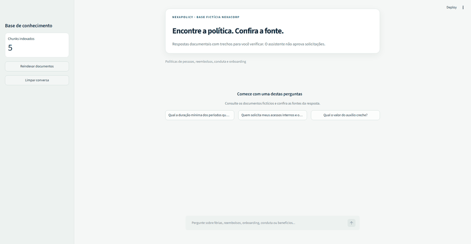
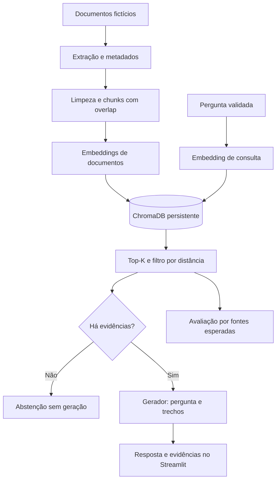

# NexaPolicy

**Um assistente documental para políticas internas, feito para demonstrar engenharia de RAG.**

Consulte férias, reembolsos, benefícios e onboarding da NexaCorp fictícia. As respostas podem reunir informações de vários documentos e mostram trechos para conferência. O projeto reúne ingestão de arquivos, embeddings, ChromaDB, geração com Gemini ou Groq e avaliação de recuperação.

> Demonstração de portfólio com dados fictícios. Não há uso por empresa real ou impacto de negócio medido. O sistema não aprova solicitações. Citações ajudam a conferir a origem, mas não garantem que cada afirmação esteja correta.

[Começar](#executar) · [Arquitetura](#arquitetura) · [Testes e avaliações](#testes-e-avaliação) · [Roteiro da demonstração](docs/demo.md)

## Demonstração

O GIF percorre três situações com a base fictícia: uma resposta com fonte, uma pergunta composta que consulta dois documentos e uma pergunta sem evidência, que recebe uma abstenção.



[Tela inicial](docs/images/nexapolicy-home.png) · [Resposta com fonte](docs/images/nexapolicy-cited-answer.png) · [Pergunta composta e duas fontes](docs/images/nexapolicy-multisource.png) · [Abstenção](docs/images/nexapolicy-abstention.png)

Capturas feitas localmente com documentos fictícios. Elas ilustram exemplos observados e não representam uma garantia geral de precisão.

## O que este projeto demonstra

- Ingestão recursiva de PDF, DOCX, XLSX, PPTX, Markdown, CSV, JSON e HTML, com metadados e IDs SHA-256 determinísticos.
- Embeddings Gemini ou Ollama e índice ChromaDB persistente, com busca por distância de cosseno.
- Até `TOP_K` trechos abaixo do limiar, permitindo contexto com múltiplas fontes.
- Evidências com caminho relativo, localização, texto e distância. Respostas sem citação válida geram erro de validação, distinto da abstenção por ausência de informação. A checagem não verifica se a fonte sustenta a afirmação.
- Abstenção sem geração quando nenhum trecho passa pelo limiar. A mensagem padrão de abstenção retornada pelo modelo também não recebe fontes.
- Avaliação de recuperação com 15 perguntas curadas, incluindo duas compostas e quatro sem resposta.
- Testes sem credenciais, incluindo Chroma real com vetores controlados e interface Streamlit com serviços simulados; workflow de CI.
- Reindexação em coleção separada, com troca após escrita completa e fingerprint da base e dos parâmetros de indexação.
- Docker com usuário não privilegiado, healthcheck HTTP e volume para o índice.

## Arquitetura



`RagAgent.retrieve` atende aplicação e avaliação. O avaliador reconstrói um índice Chroma em memória, sem alterar a coleção persistida, e não chama a geração. [Decisões e limites da arquitetura](docs/architecture.md).

## Executar

Requer Python 3.12 e uma chave para o provedor de geração escolhido. A combinação padrão usa Gemini; Groq com Ollama requer chave Groq e serviço Ollama local. Testes automatizados não precisam de chave.

```bash
git clone https://github.com/PxS00/nexa-policy.git
cd nexa-policy
python -m venv .venv
```

Ative com `source .venv/bin/activate` no Linux/macOS ou `.venv\Scripts\Activate.ps1` no PowerShell.

```bash
python -m pip install -r requirements-dev.lock
```

Copie `.env.example` para `.env` (`cp .env.example .env` ou `Copy-Item .env.example .env` no PowerShell). Para a configuração padrão, defina `GEMINI_API_KEY` e confirme os modelos disponíveis na sua conta. Nunca versione chaves.

Para usar Groq na geração, configure `LLM_PROVIDER=groq`, `GROQ_API_KEY` e `GROQ_MODEL` no `.env`. O padrão é `openai/gpt-oss-20b`; confirme sua disponibilidade e limites na conta Groq. A geração usa a API Groq e sua quota; uma pergunta de teste sobre férias produziu resposta correta com citação, o que não constitui avaliação completa de qualidade.

Para gerar embeddings localmente sem chave Gemini, instale [Ollama](https://ollama.com/download), execute `ollama pull embeddinggemma` e mantenha o serviço em execução. Configure `EMBEDDING_PROVIDER=ollama`, `OLLAMA_MODEL=embeddinggemma`, `EMBEDDING_DIMENSIONS=768`, `LLM_PROVIDER=groq` e a chave Groq. O Ollama usa prefixos específicos para documentos e perguntas; outros modelos exigem verificar seus próprios requisitos. Embeddings são gerados localmente, mas os trechos recuperados e a pergunta são enviados à Groq para gerar a resposta.

Use uma coleção separada como `CHROMA_COLLECTION=corporate_documents_ollama` e reindexe ao mudar de provedor ou modelo. Distâncias e limiares dependem do modelo: os resultados e o limiar medidos com Gemini não validam a qualidade do EmbeddingGemma. A aplicação bloqueia consultas se o fingerprint do índice não corresponder à configuração.

```bash
streamlit run app.py
```

Abra [localhost:8501](http://localhost:8501). A primeira execução indexa `documents/` e faz chamadas de embeddings. A reindexação manual gera novas chamadas e prepara uma coleção completa antes de trocar a coleção ativa. Índices antigos sem fingerprint exigem reindexação manual; mudanças de documentos ou de configuração também bloqueiam novas consultas até reindexar.

### Configuração

| Variável | Padrão | Uso |
| --- | --- | --- |
| `GEMINI_API_KEY` | sem valor | Credencial |
| `LLM_PROVIDER` / `GROQ_API_KEY` / `GROQ_MODEL` | `gemini` / sem valor / `openai/gpt-oss-20b` | Seleção e configuração da geração Groq |
| `EMBEDDING_PROVIDER` / `OLLAMA_MODEL` | `gemini` / `embeddinggemma` | Provedor e modelo local de embeddings |
| `LLM_MODEL` | `gemini-3.5-flash` | Geração |
| `LLM_FALLBACK_MODEL` | `gemini-3.5-flash-lite` | Alternativa após erro 503 |
| `EMBEDDING_MODEL` | `gemini-embedding-001` | Embeddings |
| `EMBEDDING_DIMENSIONS` | `768` | Dimensão dos vetores |
| `DOCUMENTS_PATH` | `documents` | Base documental |
| `CHROMA_PATH` | `.chroma` | Persistência |
| `CHROMA_COLLECTION` | `corporate_documents` | Coleção |
| `CHUNK_SIZE` / `CHUNK_OVERLAP` | `1000` / `150` | Caracteres / sobreposição |
| `TOP_K` | `4` | Máximo de trechos |
| `MAX_COSINE_DISTANCE` | `0.65` | Distância máxima aceita |

Distância menor significa proximidade vetorial; não é probabilidade de correção. O limiar é heurístico, sem calibração empírica publicada. Ao mudar modelo ou dimensão dos embeddings, use uma nova coleção ou reindexe antes de consultar.

### Docker

Com `.env` configurado e Docker ativo:

```bash
docker compose up --build -d
docker compose logs -f agent
docker compose down
```

O volume `chroma-data` mantém o índice. O healthcheck verifica o servidor HTTP, sem garantir disponibilidade do Gemini ou qualidade das respostas.

Para Ollama executando no Windows com a aplicação no Docker Desktop, o Compose aponta para `host.docker.internal:11434`; ajuste `OLLAMA_DOCKER_BASE_URL` se necessário e verifique se o serviço está acessível ao container. Essa conexão não foi validada nesta revisão. Para execução diretamente no Windows, `OLLAMA_BASE_URL` usa `http://127.0.0.1:11434` por padrão.

## Testes e avaliação

A [matriz de revisão funcional e de confiabilidade](docs/review-scenarios.md) registra cenários, correções e riscos ainda abertos. Os experimentos de recuperação, divisão de perguntas e busca híbrida estão resumidos em [avaliação exploratória](evals/hybrid-analysis.md); não alteraram a busca da aplicação.

```bash
python -m pytest -q
python -m pytest --cov=src --cov-report=term-missing
```

Testes verificam extração, chunking, contrato RAG, evidências, abstenção, cálculo das métricas, busca Chroma e fluxo da interface. Respostas e embeddings simulados não medem a qualidade do Gemini.

Para medir a recuperação real, configure a chave e execute na raiz do projeto:

```bash
python -m src.evaluation --output evals/reports/retrieval.json
```

O comando usa o provedor de embeddings configurado: Gemini pode consumir quota/cobrança; Ollama gera os vetores localmente. O relatório registra recall de fontes, MRR, recuperação de todas as fontes, abstenção correta, tempo de recuperação, configuração, revisão e hashes do corpus/dataset. [Metodologia](evals/README.md).

### Baseline real de recuperação

Em 28/10/2026, com Gemini `gemini-embedding-001`, cinco documentos fictícios, limiar 0,65 e 15 perguntas curadas (11 respondíveis e quatro negativas):

| Configuração | Todas as fontes esperadas | Abstenção na recuperação para negativas |
| --- | --- | --- |
| top-1 | 9/11 | 0/4 |
| top-4 | 11/11 | 0/4 |

Top-4 recuperou as fontes das duas perguntas compostas; o filtro não rejeitou nenhuma negativa. Isso é um experimento pequeno de recuperação por documento, não uma medida de qualidade de respostas nem resultado em produção. Os relatórios incluem distâncias, tempos, configuração, hash e revisão: [top-1](evals/baselines/retrieval-top1.json) e [top-4](evals/baselines/retrieval-top4.json). A revisão registrada antecede a validação de citações, que não altera a recuperação. [Registro de validação](docs/validation.md).

Com `embeddinggemma` local, top-4 e limiar 0,65, todos os documentos esperados foram recuperados em 11/11 perguntas respondíveis nos dois conjuntos de 15 casos. A recuperação rejeitou 2/4 negativas no conjunto de desenvolvimento e 0/4 no conjunto separado. [Dados de desenvolvimento](evals/baselines/ollama-development.json) e [dados do conjunto separado](evals/baselines/ollama-holdout.json). São amostras pequenas dos mesmos cinco documentos, sem avaliação automática de correção das respostas. Os arquivos foram produzidos com alterações locais ainda não commitadas; a revisão Git registrada não identifica o código completo da execução.

Uma comparação posterior de top-2 e top-4 com Ollama mostrou menos fontes extras com top-2 nos conjuntos anteriores, mas um novo conjunto de estresse revelou perda de fontes nas três perguntas que exigem três documentos. Por isso, o padrão permanece top-4. A recuperação das perguntas negativas não melhorou. A classificação de fontes citadas verifica a referência textual, não se cada afirmação é sustentada. [Método, resultados e limites](evals/top-k-analysis.md).

Com Ollama e Groq, uma avaliação real do conjunto separado teve 11 respostas revisadas com fatos e fontes esperadas e quatro abstenções corretas. Um dos casos negativos falhou na primeira execução e foi repetido. [Execução inicial](evals/baselines/groq-ollama-holdout-attempt.json), [repetição dos casos](evals/baselines/groq-ollama-holdout-followup.json) e [revisão manual](evals/baselines/groq-ollama-holdout-review.json). A revisão foi realizada nesta tarefa, sem avaliador independente, em uma amostra pequena; não mede confiabilidade em produção.

Em uma rodada exploratória de geração com a validação de citações ativa, 10 das 15 perguntas retornaram respostas; cinco falharam por limite de quota (429). As quatro negativas que retornaram resposta receberam a abstenção padrão; uma pergunta respondível também recebeu abstenção e outra resposta ficou incompleta. [Respostas e erros registrados](evals/baselines/answers-exploratory.json). A rodada não mede precisão geral, e a razão da abstenção indevida não foi identificada.

Em 29/10/2026, uma execução parcial do conjunto separado registrou dois casos revisados, uma interrupção por `MAX_TOKENS` e três erros 503, antes de ser interrompida; a avaliação dos demais casos continua pendente. [Relatório parcial](evals/baselines/holdout-2026-10-29-partial.json) e [análise exploratória de limiar](evals/threshold-analysis.md).

Respostas cuja geração termina de forma anormal são agora rejeitadas, evitando exibir texto parcial. Para preparar uma revisão manual de fatos e citações, execute `python -m src.evaluate_answers`; o relatório registra resultados parciais e para no primeiro erro. [Instruções de revisão](evals/README.md).

## Demonstração

O [roteiro de demonstração curta](docs/demo.md) inclui uma consulta, conferência de fonte e discussão de uma limitação observada.

1. “Com qual antecedência devo solicitar férias?” — confira o trecho em `rh/politica_ferias.md`.
2. “Quais treinamentos preciso fazer na primeira semana e qual é a verba anual para cursos?” — examine se as duas fontes necessárias são recuperadas; esse acerto precisa ser medido com embeddings reais.
3. “Qual é o valor do auxílio estacionamento?” — examine a abstenção e registre falhas; semelhança com benefícios não prova que a resposta exista.

## Deploy: evidências históricas

O README original registra OCI Compute com Ubuntu 24.04 e Docker Compose. As capturas versionadas mostram a interface anterior em endereço público na porta 8501, uma resposta e uma abstenção. Não comprovam disponibilidade atual, infraestrutura reproduzível, SLA ou implantação desta nova versão.


Na segunda captura a versão anterior ainda anexava `faq.md` à abstenção. Esta evolução remove fontes da mensagem padrão. Não foi realizado novo deploy nesta revisão.

## Próximos passos e limites

Próximo marco: baseline real, comparação top-1/top-k e calibração com dados separados; depois integridade do índice e avaliação das respostas. [Diagnóstico e plano com critérios de conclusão](docs/portfolio-plan.md).

Limitações: cinco documentos fictícios; sem autenticação, autorização por documento, OCR, sincronização externa, reranking ou observabilidade centralizada. Reindexação é integral; coleções anteriores e tentativas com resultado ambíguo podem ocupar espaço. O bloqueio coordena processos locais que compartilham o mesmo diretório, não instalações distribuídas. Histórico é exibido na sessão, mas não enviado como memória ao modelo. Os arquivos `.lock` fixam versões, mas não incluem hashes de pacotes. O protótipo não está pronto para documentos confidenciais.

O [escopo proposto para acesso por usuário e documento](docs/access-design.md) define critérios de teste; ainda não está implementado.

## Origem e autoria

Desenvolvido por Lucas Rossoni para o Challenge AluraAgente — ONE IA for Tech, originalmente **Alura Corporate Agent**. NexaPolicy explicita o domínio e aproveita a empresa fictícia existente; nome proposto para o portfólio, sem pesquisa de marca. O endereço do repositório foi preservado.


